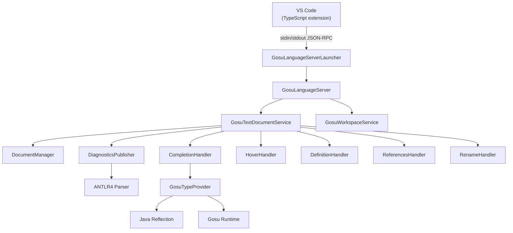

# Gosu LSP

[](LICENSE)
[](CHANGELOG.md)

A Language Server Protocol (LSP) implementation for the [Gosu programming language](https://gosu-lang.github.io/), providing Java-like IDE features for `.gs` and `.gsx` files in VS Code.

## Features

- **Syntax highlighting** — TextMate grammar covering keywords, types, strings, comments, annotations, and operators
- **Diagnostics** — real-time syntax errors via an ANTLR4 parser
- **Code completion** — Gosu keywords, built-in types, symbols declared in the current file, and type-aware member completions (triggered by `.`)
- **Hover** — shows the declaration signature of the symbol under the cursor
- **Go-to-definition** — jumps to the declaration of any symbol, including across open files
- **Find all references** — locates every usage of a symbol across all open documents
- **Rename symbol** — renames a symbol and all its occurrences in every open file
- **Document outline** — lists all classes, functions, properties, and variables in the file

## Requirements

| Tool | Version |
|---|---|
| Java | 17 or higher |
| Gradle (wrapper) | 8.8 |
| Node.js | 18 or higher |
| VS Code | 1.85 or higher |

## Project Structure

```
gosu-lsp/
├── server/                          # Java Gradle subproject (LSP server)
│   ├── build.gradle
│   └── src/main/
│       ├── antlr/com/gosu/lsp/
│       │   └── GosuLanguage.g4      # ANTLR4 grammar for Gosu
│       └── java/com/gosu/lsp/
│           ├── GosuLanguageServerLauncher.java
│           ├── GosuLanguageServer.java
│           ├── GosuTextDocumentService.java
│           ├── GosuWorkspaceService.java
│           ├── analysis/
│           │   ├── GosuSourceParser.java
│           │   ├── DiagnosticsPublisher.java
│           │   ├── GosuSymbolExtractor.java
│           │   └── GosuTypeProvider.java
│           ├── document/
│           │   └── DocumentManager.java
│           └── handlers/
│               ├── CompletionHandler.java
│               ├── HoverHandler.java
│               ├── DefinitionHandler.java
│               ├── ReferencesHandler.java
│               └── RenameHandler.java
├── client/                          # TypeScript VS Code extension
│   ├── package.json
│   ├── tsconfig.json
│   ├── language-configuration.json
│   ├── syntaxes/
│   │   └── gosu.tmLanguage.json
│   └── src/
│       └── extension.ts
├── build.gradle                     # Root build — shared repo config
├── settings.gradle
└── gradlew.bat
```

## Building

### 1 — Build the server JAR

```bat
.\gradlew.bat :server:shadowJar
```

The fat JAR is produced at `server/build/libs/gosu-lsp-server.jar`.

To also copy it into `client/server/` for packaging:

```bat
.\gradlew.bat :server:copyServerJar
```

### 2 — Build the VS Code extension

```bat
cd client
npm install
npm run compile
```

Compiled JavaScript is written to `client/out/` (configured in `client/tsconfig.json`).

### 3 — Build the VSIX in one step

The `build-vsix.ps1` script at the repo root chains steps 1 and 2 together and produces the packaged extension:

```powershell
.\build-vsix.ps1
```

The resulting `.vsix` file is written to `client/`.

## Installing the Extension

### Option A — Install directly from the compiled output (quickest)

Point VS Code at the `client/` folder without packaging:

```bat
code --install-extension client
```

Or in VS Code: **Extensions** → `...` menu → **Install from VSIX…** → select `client/`.

### Option B — Package as a VSIX then install

The quickest way is the all-in-one script (no global tools required):

```powershell
.\build-vsix.ps1
```

Or manually:

1. Build and copy the server JAR:
   ```bat
   .\gradlew.bat :server:copyServerJar
   ```
2. Package the extension (`@vscode/vsce` is fetched automatically via `npx`):
   ```bat
   cd client
   npx --yes @vscode/vsce package
   ```
   This produces `client/gosu-lsp-<version>.vsix`.
3. Install:
   ```bat
   code --install-extension gosu-lsp-<version>.vsix
   ```
   Or in VS Code: **Extensions** → `...` → **Install from VSIX…** → select the `.vsix` file.

## Running in VS Code (development)

1. Build both the server JAR and the client (steps above).
2. Open `client/` as a VS Code workspace (or the repo root).
3. Press **F5** to launch the Extension Development Host.
4. Open any `.gs` or `.gsx` file — the Gosu Language Server starts automatically.

## Architecture



The server communicates over **stdio** using the [LSP 3.18 specification](https://microsoft.github.io/language-server-protocol/specifications/lsp/3.18/specification/).  
The grammar is implemented with **ANTLR4 4.13.2**, based on the [Gosu EBNF grammar](https://gosu-lang.github.io/grammar.html).  
Type-aware completions use Java reflection for JDK types and the Gosu runtime (`gosu-core`) for Gosu-specific types, with graceful fallback if the runtime cannot initialise.

## Roadmap

| Phase | Scope | Status |
|---|---|---|
| **1** | Syntax highlighting, diagnostics, completion, hover, go-to-definition | ✅ Done |
| **2** | Type-aware completions, rename symbol, find all references | ✅ Done |
| **3** | Format document, code actions, inlay hints | ✅ Done |

## License

MIT — see [LICENSE](LICENSE) for details.
